# SonicBoom studio tour — 480 px demo

Visual guide to the redesigned studio at a 480×480 viewport (mobile), with
1280×800 desktop references. Shots are captured with Playwright against the
mocked API fixtures, so every screen renders without a backend or model.

Regenerate after any UI change:

```bash
cd frontend
npm run build
node --experimental-strip-types tour/capture.mts
```

The script serves `dist/` through `tests/e2e/server.mjs`, walks every tab in
English light/dark schemes, and writes this folder. It exits non-zero when a
screen fails to render, so it doubles as a smoke check.

## Create — editor first, result beside it

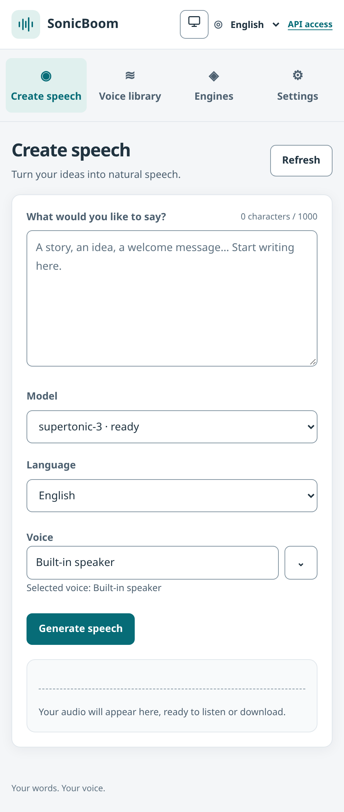

One label, one counter, one primary action. Byte counts appear only near the
server limit; the last voice, model, and language are remembered. Every
finished generation shows a waveform player (wavesurfer.js) with its own
transport, so the recording can be scrubbed without the native controls.

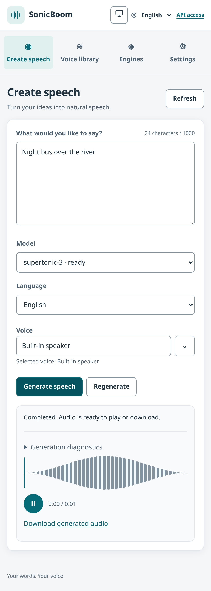
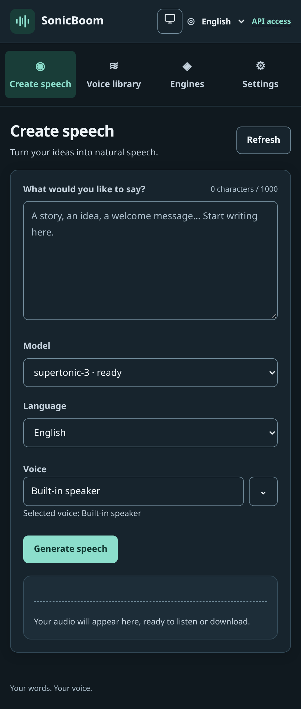

## Voice library — compact cards, creator in a dialog

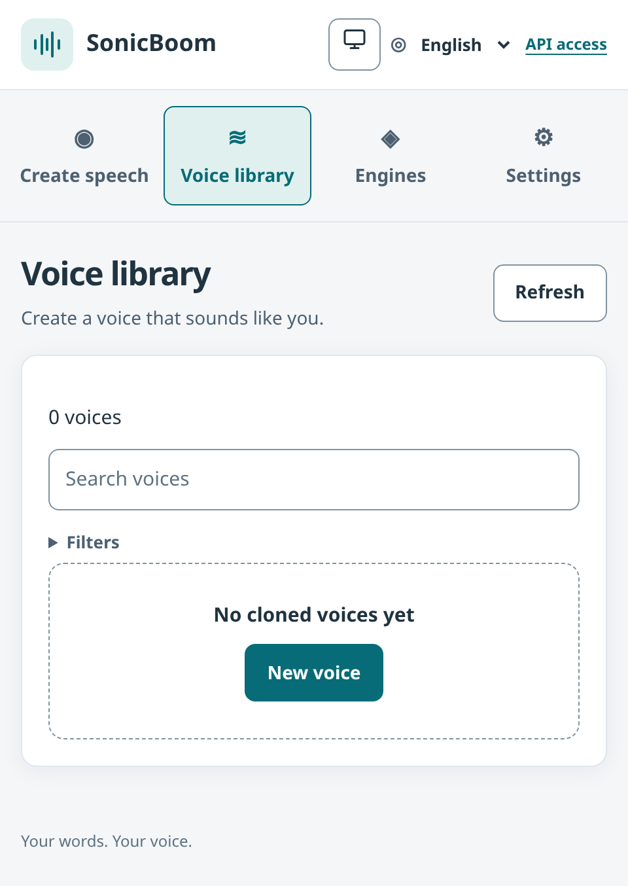

Search stays visible; engine/language/model/sort filters collapse into
`Filters` with an active-count badge. Each card shows a status dot and hides
technical detail behind `Details`.

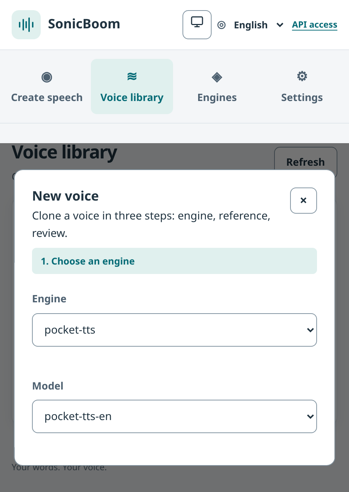
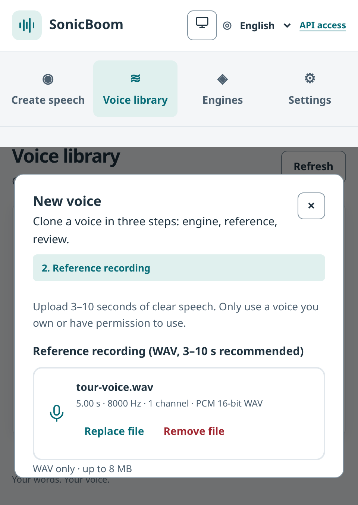

`New voice` opens an accessible modal (focus trap, `Esc` to close,
full-height scroll on small screens) hosting the three-step clone wizard.
`Esc` returns focus to the button that opened it. The reference step uses a
drag-and-drop zone that turns into a file card with the recording details, a
duration hint and a waveform player; the trim editor keeps its waveform and
stats while health advice collapses into `Recording health notes`.

## Engines — status you can scan, diagnostics on demand

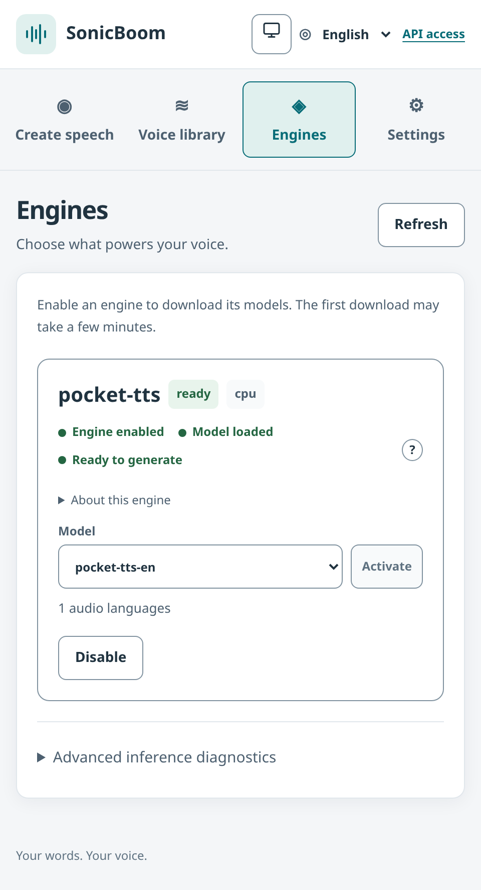

Three status dots (enabled / model loaded / ready) plus one `?` tooltip
replace the diagnostic dump; engine-specific notes and the Vulkan/CPU solution
live behind disclosures. Pocket's six per-model Activate buttons collapsed
into one model picker with a single Activate action.

## Settings — one line per setting

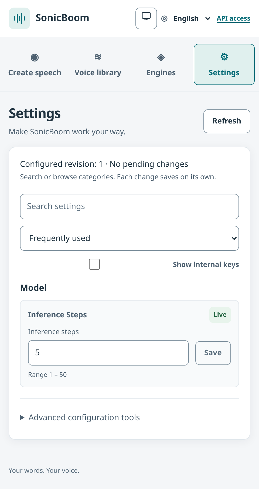

Internal keys (`audio.output_device`, …) stay hidden behind `Show internal
keys`. Each row saves on its own with an apply badge.

## Desktop references (1280×800)

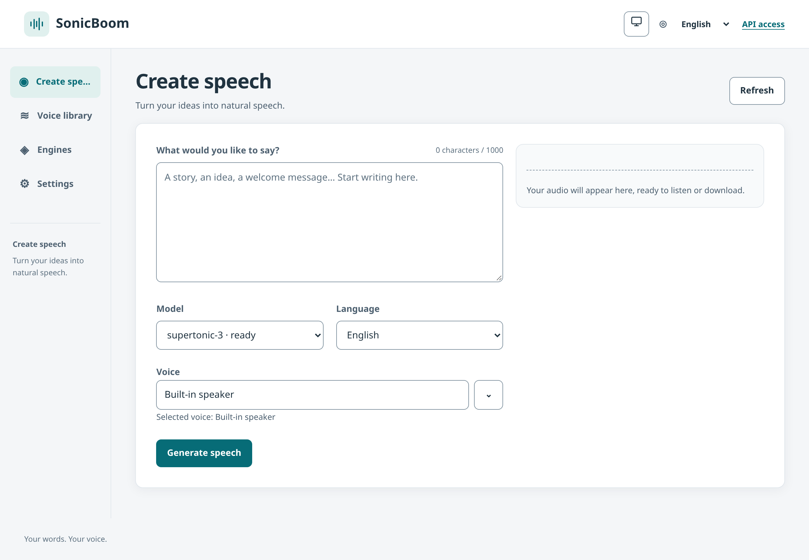
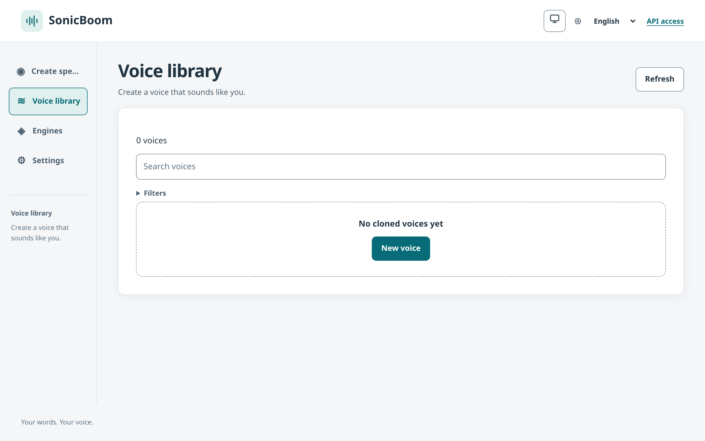
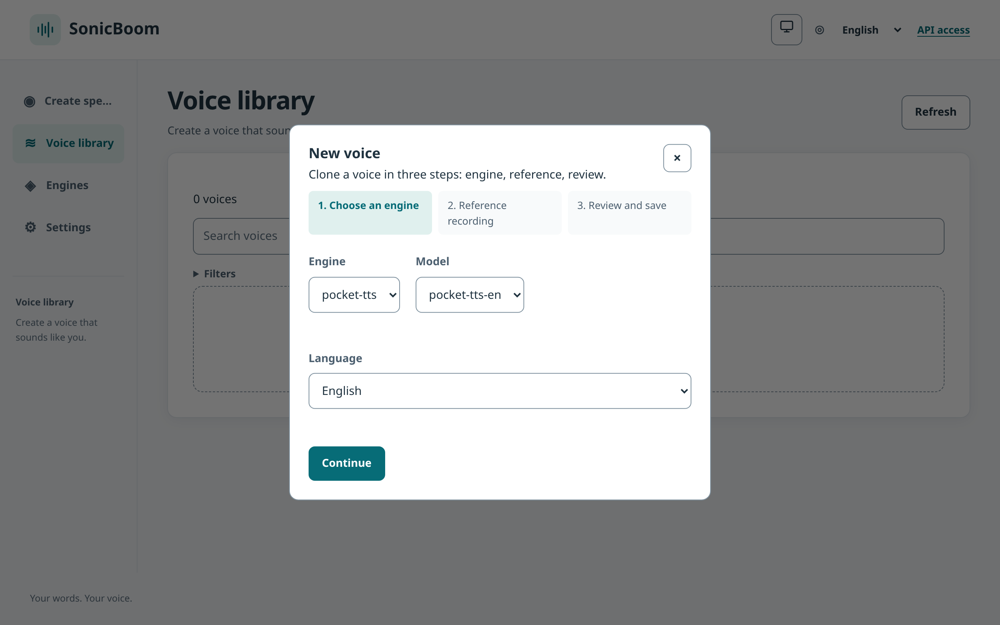
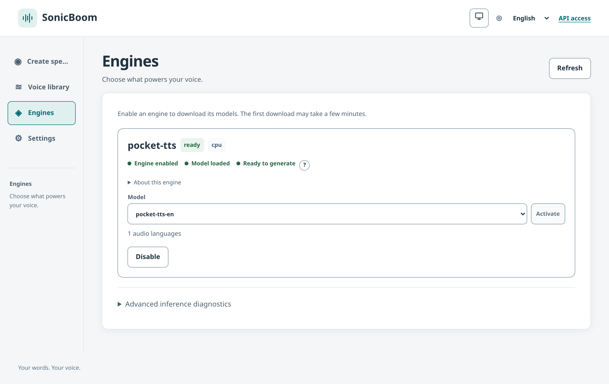
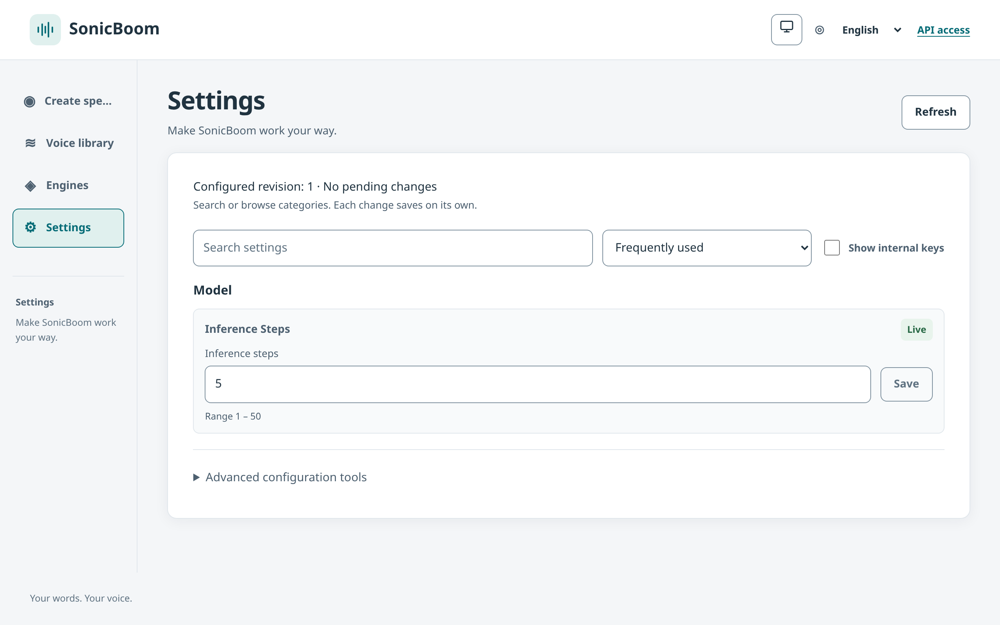
